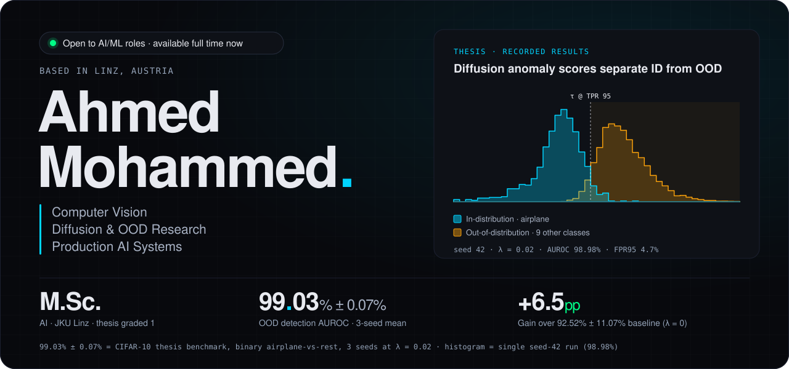

<a href="https://ahmed-3m.github.io/">
  <picture>
    <source media="(prefers-color-scheme: dark)" srcset=".github/readme/hero-dark.svg">
    <source media="(prefers-color-scheme: light)" srcset=".github/readme/hero-light.svg">
    
  </picture>
</a>

  
  
  
  
  
  

<code>// About</code>

## AI/ML engineer — research that ships.

I'm an AI/ML engineer in **Linz, Austria**. I build reliable vision and agentic AI systems that pair probabilistic models with deterministic guardrails — across industrial print inspection, diffusion OOD detection, and LLM/agent tooling.

- **M.Sc. in Artificial Intelligence, JKU Linz** — graduated September 2026 (Defensio 25 Sep 2026). Thesis on conditional diffusion models for out-of-distribution (OOD) detection, supervised by **Prof. Sepp Hochreiter**, **graded 1** (top mark).
- **Background:** mechatronics and electronics before AI, so I bring a hardware and systems view to computer vision and production ML.
- **Open to:** AI/ML engineering roles and research collaborations. Available full time now (eligible for Austria's Rot-Weiß-Rot Karte für Studienabsolventen — no labour-market test). Full background on <a href="https://ahmed-3m.github.io/about/">About</a>.

<code>// Experience</code>

## Experience & independent work.

| When | Role | Where |
| :--- | :--- | :--- |
| May 2026 – present | **Solo developer & project lead** for Sihem, a planning and daily-routine assistant | tech2b incubator, Linz |
| May 2026 – present | **Freelance AI consultant** for small and medium-sized businesses, covering AI integration, workflow automation, and LLM applications | Remote |
| Jul 2026 | **M.Sc. thesis submitted** on diffusion-based OOD detection for inkjet print quality control | Johannes Kepler University Linz |
| Apr – Nov 2024 | **Machine vision research contract** on the Zer0P project. Built a two-stage pipeline for inspecting experimental inkjet prints. | PROFACTOR GmbH, Steyr (remote) |
| Aug – Oct 2023 | **AI research intern**: RNN/CNN models for EEG motor-imagery classification | Karunya Institute of Technology and Sciences, India |
| Sep 2018 – Oct 2020 | **Electronics technician**: PCB assembly, circuit build-up, fault finding and test | Ledzone, Istanbul |

<code>// Projects</code>

## Selected work

<table>
  <tr>
    <td width="50%" valign="top">
      <code>MASTER'S THESIS · JKU LINZ · GRADED 1</code>
      <h3>DiffusionOOD</h3>
      Trains an image model to flag pictures from outside a familiar category. A class-conditional separation loss made results stable across random seeds.  
      <b>99.03% ± 0.07% AUROC</b> 
      CIFAR-10 airplane vs. the other 9 classes (binary) · 3-seed mean · +6.5 pp over 92.52% ± 11.07% · <a href="https://ahmed-3m.github.io/Mohammed_Ahmed_Thesis_Diffusion_OOD_Detection.pdf">Thesis PDF</a>  
      <a href="https://ahmed-3m.github.io/case-studies/diffusion-ood/">Case study</a> ·
      <a href="https://github.com/ahmed-3m/DiffusionOOD">Code</a> ·
      <a href="https://huggingface.co/ahmed-3m/DiffusionOOD">Weights and raw scores</a>
    </td>
    <td width="50%" valign="top">
      <code>THESIS TRACK 2 · INDUSTRIAL CV · PROFACTOR</code>
      <h3>InkjetOOD</h3>
      A two-stage system for defects in industrial inkjet printing: YOLOv8m localizes 8 print feature types into 6,408 128×128 crops across 573 source-image groups, then a multi-head conditional diffusion model scores each crop.  
      <b>0.8673 ± 0.0230 AUROC</b> 
      Public FTI_Zer0P dataset · five-fold cross-validation · λ = 0 baseline. The separation loss showed no reliable gain in this evaluation.  
      <a href="https://ahmed-3m.github.io/case-studies/inkjet-ood/">Case study</a> ·
      <a href="https://github.com/ahmed-3m/InkjetOOD">Code</a> ·
      <a href="https://huggingface.co/ahmed-3m/InkjetOOD">Weights</a>
    </td>
  </tr>
  <tr>
    <td width="50%" valign="top">
      <code>INDEPENDENT PROJECT · TECH2B INCUBATOR</code>
      <h3>Sihem</h3>
      A personal assistant for weekly planning and daily routines, built around a deterministic <code>generators → arbiter → composer</code> loop, Supabase PostgreSQL with row-level security, <code>pgvector</code> RAG long-term memory, and multi-provider LLM routing with failover. The Telegram bot and web app are in invitation-only beta; the native Android app (Kotlin / Jetpack Compose) is in private testing. The case study includes an interactive 3-scenario illustrative walkthrough of the invitation-only beta.  
      <a href="https://ahmed-3m.github.io/case-studies/sihem/">Case study &amp; walkthrough</a> ·
      <a href="https://t.me/sihem_ai_bot">Telegram (invite only)</a> ·
      <a href="https://sihem-pwa.pages.dev/">Web app (invite only)</a>
    </td>
    <td width="50%" valign="top">
      <code>DEVELOPER TOOL · OPEN SOURCE</code>
      <h3>mergeproof</h3>
      A zero-dependency deterministic merge gate for AI-agent pull requests. It makes 0 LLM calls and returns <code>MERGE</code>, <code>RETRY</code>, or <code>HUMAN</code> against configured merge requirements — for example, flagging edits to existing tests for human review. Try it in the live client-side PR gate playground on the portfolio (0 LLM calls). Passing checks does not guarantee defect-free code.  
      <a href="https://ahmed-3m.github.io/?view=full#mergeproof-playground">Interactive playground</a> ·
      <a href="https://github.com/ahmed-3m/mergeproof">Code</a> ·
      <a href="https://github.com/ahmed-3m/mergeproof#quick-start">See example</a> ·
      <a href="https://www.npmjs.com/package/@ahmed-3m/mergeproof">npm</a>
    </td>
  </tr>
</table>

Also: <a href="https://github.com/ahmed-3m/Motor-Imagery-classification">EEG motor-imagery classification</a> · <a href="https://github.com/ahmed-3m/brainstorm2idea">brainstorm2idea</a> · <a href="https://github.com/ahmed-3m/idea2prototype">idea2prototype</a> · <a href="https://github.com/ahmed-3m/Elbostan-Pazar-bot">Elbostan Pazar bot</a>

<code>// Research</code>

## The thesis in one table.

The model scores an image by how well a class-conditional diffusion model reconstructs it under competing class hypotheses. Training adds a separation term, $`\mathcal{L} = \mathcal{L}_{\text{diffusion}} + \lambda \cdot \mathcal{L}_{\text{sep}}`$, and at $`\lambda = 0.02`$ the spread across seeds drops from ±11.07 to ±0.07 points.

| Test set | AUROC | Setting |
| :--- | ---: | :--- |
| **CIFAR-10 airplane vs. rest** | **99.03% ± 0.07%** | 3-seed mean, λ = 0.02 (headline) |
| CIFAR-10 airplane vs. rest | 92.52% ± 11.07% | 3-seed mean, λ = 0 baseline |
| CIFAR-100 | 96.97% | seed 42, K = 100 (thesis Table 6.1) |
| Places365 | 96.50% | seed 42, K = 100 (thesis Table 6.1) |
| FashionMNIST | 94.03% | seed 42, K = 100 (thesis Table 6.1) |
| Textures | 92.84% | seed 42, K = 100 (thesis Table 6.1) |
| SVHN | 90.50% | seed 42, K = 100 (thesis Table 6.1) |

These are binary detection scores with CIFAR-10 airplanes as the in-distribution class. The external datasets supply out-of-distribution images for the single-seed runs. All figures come from the <a href="https://ahmed-3m.github.io/Mohammed_Ahmed_Thesis_Diffusion_OOD_Detection.pdf">thesis</a> and are mirrored in <a href="src/lib/ood-explorer-data.ts"><code>src/lib/ood-explorer-data.ts</code></a>. See the <a href="https://ahmed-3m.github.io/research/">research overview</a>, the <a href="https://epub.jku.at/obvulihs/content/titleinfo/14374221">official JKU library record</a>, or drag the threshold yourself in the <a href="https://ahmed-3m.github.io/case-studies/diffusion-ood/#ood-explorer">interactive explorer</a>.

<code>// Writing</code>

## Selected writing.

- **[Deterministic Guardrails for LLM and Agent Systems: Sihem's Arbiter and mergeproof](https://ahmed-3m.github.io/blog/deterministic-guardrails-for-llm-and-agent-systems/)** *(Nov 2026)* — Separating deterministic scheduling, state, and diff verification from probabilistic LLM synthesis.
- **[How I Reached 99.03% AUROC on OOD Detection with Conditional Diffusion Models](https://ahmed-3m.github.io/blog/ood-diffusion-thesis/)** *(Jul 2026)* — Class-conditional separation loss, seed stability, and cross-domain boundary conditions.
- **[Diffusion Models for Industrial Defect Detection at PROFACTOR GmbH](https://ahmed-3m.github.io/blog/diffusion-models-anomaly-detection/)** *(Nov 2024)* — Evaluating a two-stage YOLOv8m + conditional diffusion pipeline on `FTI_Zer0P` under 5-fold CV.
- **[YOLOv8 for Industrial Quality Control: Decisions That Actually Moved the Needle](https://ahmed-3m.github.io/blog/computer-vision-yolo-mastery/)** *(Oct 2024)* — Feature extraction, stratified fold design, and edge-deployment trade-offs.

<code>// Stack</code>

## What I work with.

| | |
| :--- | :--- |
| **ML & vision** | PyTorch, PyTorch Lightning, diffusion models (DDPM, UNet), YOLOv8, anomaly / OOD detection, Hugging Face |
| **Evaluation** | AUROC, FPR95, cross-validation, seed sweeps, Hydra, Weights & Biases, CUDA |
| **Product & agents** | TypeScript, React, Next.js, PostgreSQL / Supabase, `pgvector`, Deno, Kotlin / Jetpack Compose, Cloudflare Workers, Telegram bots, `mergeproof` |
| **Ops** | Docker, Linux, GitHub Actions CI/CD |

<code>// This repo</code>

## How this site is built.

<table>
  <tr>
    <td valign="top" width="50%">
      <b>Stack</b> 
      Next.js 16 (App Router) · React 19 · TypeScript · Tailwind CSS v4, statically exported and deployed to GitHub Pages by <a href=".github/workflows/deploy.yml">GitHub Actions</a>, gated by an automated static-export integrity verifier (<code>npm run verify:export</code>) and a headless Chromium Playwright RTL/mobile smoke check.
    </td>
    <td valign="top" width="50%">
      <b>Design</b> 
      Shared tokens (<code>--cd-*</code> and <code>--stage-glass-*</code> in <a href="src/app/globals.css"><code>globals.css</code></a> and <a href="src/app/portfolio.css"><code>portfolio.css</code></a>) drive a dark theme and a warm cream light theme. Space Grotesk, Inter, JetBrains Mono, and IBM Plex Sans Arabic.
    </td>
  </tr>
  <tr>
    <td valign="top">
      <b>Languages</b> 
      English, German, French, Spanish, and Arabic, with pre-paint theme and <code>lang</code>/<code>dir</code> restoration and a full right-to-left layout for Arabic.
    </td>
    <td valign="top">
      <b>Live pieces</b> 
      Dedicated <a href="https://ahmed-3m.github.io/about/">About</a>, <a href="https://ahmed-3m.github.io/research/">Research</a>, <a href="https://ahmed-3m.github.io/blog/">Blog</a>, <a href="https://ahmed-3m.github.io/news/">News</a>, <a href="https://ahmed-3m.github.io/impressum/">Impressum</a>, and <a href="https://ahmed-3m.github.io/privacy/">Privacy</a> routes, an interactive thesis explorer, a live client-side <a href="https://ahmed-3m.github.io/?view=full#mergeproof-playground"><code>mergeproof</code> PR gate playground</a> (0 LLM calls), an interactive 3-scenario illustrative Sihem beta walkthrough on <a href="https://ahmed-3m.github.io/case-studies/sihem/"><code>/case-studies/sihem/</code></a>, a <a href="worker/chat-proxy.js">Cloudflare Worker–proxied</a> chat assistant (Genie) with curated fallback answers, a live AI front-desk voice/avatar call demo, <a href="public/llms.txt"><code>llms.txt</code></a> / <a href="public/llms-full.txt"><code>llms-full.txt</code></a> context files, and a daily agent-curated AI news feed.
    </td>
  </tr>
</table>

Contributor and agent rules, including the claim-integrity rules for every number on the site, live in <a href="AGENTS.md"><code>AGENTS.md</code></a>.

---

  <b>Let's talk.</b> <a href="mailto:ahmed.mu.0905@gmail.com">ahmed.mu.0905@gmail.com</a> · <a href="https://www.linkedin.com/in/ahmed-3m/">LinkedIn</a> · <a href="https://github.com/ahmed-3m">GitHub</a> · <a href="https://wandb.ai/ahmed-mu-0593">W&amp;B</a> · <a href="https://orcid.org/0009-0004-8934-1270">ORCID</a> · <a href="https://calendly.com/ahmed-3m">Book a call</a>

